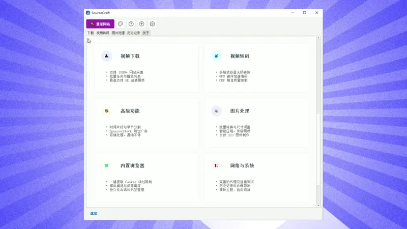

# 🚀 SourceCraft — Universal Video Downloader & Multimedia Tool

**全网万能视频下载与多媒体工具 | 1000+ 平台支持 | 基于 yt-dlp 深度定制**

> A professional all-in-one video downloader, lossless media extractor and multimedia converter for Windows — powered by a deeply customized yt-dlp engine.

---

## 🎥 Live Demo Preview (实机演示)

> *This is a compact preview. Watch the full 1080p demo video (≈35 MB):*
> 👉 **[Full HD demo video](https://github.com/lihaolong8517/SourceCraft/raw/main/assets/demo.mp4)**

---

## 📦 Download (官方下载)

👉 **[https://hundunxiazaiqi.cn/](https://hundunxiazaiqi.cn/)** 👈

The installer bundles the complete runtime (custom browser driver, ffmpeg core, etc.) and is too large for GitHub hosting — download it from the official website above for the latest version and release notes.

安装包体积较大（含独立浏览器驱动库、音视频处理内核等完整组件），无法托管于 GitHub，请前往官网下载最新版本。

---

## ✨ Features (核心功能)

### 🚀 1. Universal Downloading (全平台极速下载)
- **1000+ platforms supported**: based on a deeply customized yt-dlp engine, covering YouTube, Bilibili, TikTok, Instagram, Twitter/X, Facebook and virtually every mainstream video/audio platform.
- **Lossless source quality**: automatically detects and downloads the highest available quality — up to 4K/8K original files and lossless audio tracks; segmented streams are parsed and merged automatically.
- **High-speed engine**: optimized network concurrency to saturate your bandwidth.

### 🖼️ 2. Image Batch Processing (专业图片批处理)
- Batch format conversion between major image formats.
- One-click batch resize and smart compression.
- Built-in **ICO icon generator** — turn any image into a professional Windows icon.

### 🌐 3. Built-in Sandbox Browser (内置无痕沙盒浏览器)
- Built on Playwright — bypasses complex anti-bot pages that plain scripts can't handle.
- Visual login & cookie extraction: sign in manually inside the built-in browser, save authorized cookies, and download login-only / private / region-locked videos with ease.

### 🎨 4. Advanced Media Workflows (高级多媒体工作流)
- Glassmorphism & lighting effects for images.
- Professional format conversion via the industrial-grade **ffmpeg** engine.

---

## 🔒 Open-Source Policy (开源策略声明)

This repository is the **official showcase page** for SourceCraft. To keep the product sustainable:

- The **core application is proprietary** (closed-source). Activation is verified through the official license server, so any copy must be activated via an official license key.
- This repo hosts the demo media and release announcements only — no source code is published here.
- 本仓库仅为官方介绍与发布说明页，核心代码不开源；激活码验证走官方授权服务器，任何副本均需通过官方渠道购买激活。

We believe in transparency: the demo videos above show exactly what you get — no fake marketing screenshots.

---

## 💬 Support & Contact (支持与联系)

- 🌐 Official website: **https://hundunxiazaiqi.cn/**
- 📧 Email: **haolongli84@gmail.com**
- 💬 In-app customer service (授权码激活 / 商用购买 / 定制技术支持)

For bug reports and feature requests, please [open an issue](https://github.com/lihaolong8517/SourceCraft/issues).

---

## 📌 Disclaimer (声明)

- The project uses the **yt-dlp** engine (Unlicense). SourceCraft itself is a commercial product — **All Rights Reserved**.
- 本项目基于 yt-dlp 引擎开发；SourceCraft 为商业软件，保留所有权利。

*© 2026 SourceCraft. All rights reserved.*
